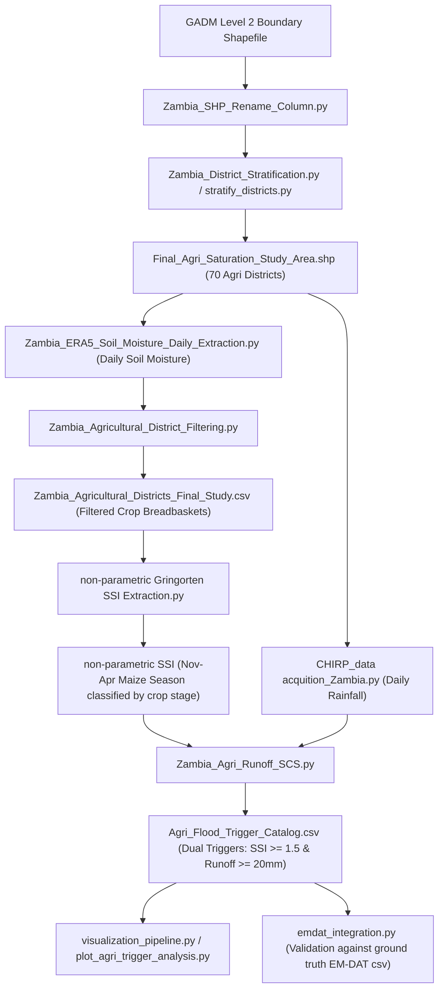

# Zambia Agricultural Flood Risk Model — Pipeline Guide

This guide details the sequential execution order and the exact function of each Python script in the dual-regime parametric flood risk study for Zambia, focusing specifically on **Agricultural Saturation Flooding (Regime B - Rural)**.

---

## 🗺️ Process Flowchart

---

## 📂 Step-by-Step Script Sequence & Methodology

The scripts should be executed in this exact sequence to build the data foundation, model the hydrology, extract triggers, and visualize the output:

### 1. Spatial Boundaries & Field Renaming
* **Script:** `utils/Zambia_SHP_Rename_Column.py`
* **Purpose:** Standardizes the shapefile fields.
* **Why it's necessary:** GADM shapefiles contain district names in standard columns like `NAME_2` or `District_N`. This script renames it to `Admin_2` to align with naming conventions in the daily climate datasets.

### 2. Dual-Regime Stratification (District Grouping)
* **Script:** `utils/Zambia_District_Stratification.py` (or `utils/stratify_districts.py`)
* **Purpose:** Separates urban flash flood zones from agricultural saturation zones.
* **How it works:** Reads built-up and cropland coverage fractions from ESA WorldCover data. If a district has $\ge 10\%$ built-up area or is an urban center, it goes to the Urban regime. If it has $< 10\%$ built-up area and $\ge 3.29\%$ cropland area, it is designated as an Agricultural district (capturing 70 districts).
* **Outputs:** 
  * `output/Final_Agri_Saturation_Study_Area.shp` (Shapefile of the 70 Agri districts)
  * `output/Zambia_Flood_Stratification_Data.csv` (Tabular statistics)
  * `output/Zambia_Stratification_SideBySide.png` (Visual map of stratification)

### 3. Climate and Soil Moisture Data Extraction
* **Rainfall Script:** `data_acquisition/CHIRP_data acquition_Zambia.py`
* **Soil Moisture Script:** `data_acquisition/Zambia_ERA5_Soil_Moisture_Daily_Extraction.py`
* **Purpose:** Downloads the historical biophysical parameters from Google Earth Engine (2000–2025).
* **How it works:**
  * The CHIRPS script extracts daily rainfall timeseries per district centroid.
  * The ERA5-Land script extracts daily volumetric soil water across three soil depth layers (0–7cm, 7–28cm, 28–100cm) per district.
* **Outputs:**
  * `output/CHIRPS_Standardized_Master.csv` (Rainfall master)
  * `output/Zambia_ERA5_Daily_Soil_Moisture_2000_2025.csv` (Soil moisture master)

### 4. Breadbasket Filtering
* **Script:** `utils/Zambia_Agricultural_District_Filtering.py`
* **Purpose:** Excludes marginal districts to isolate the core breadbaskets and reduce soil moisture background noise.
* **How it works:**
  * Applies **Tier 1 (Becker-Reshef / GEOGLAM 95% Cumulative Rule)**: Selects districts forming the top 95% cumulative national cropland area (focusing on districts driving national food security).
  * Applies **Tier 2 (Rembold / ASAP 15% Cropland Density Rule)**: Excludes districts with $< 15\%$ cropland density. In sparse cropland districts, the daily soil moisture is dominated by forests, water bodies, or grasses, resulting in noise rather than actual crop condition signals.
* **Output:** `output/Zambia_Agricultural_Districts_Final_Study.csv` (Refined soil moisture timeseries).

### 5. Soil Moisture Index (SSI) Calculation
* **Script:** `script/non-parametric Gringorten SSI Extraction.py`
* **Purpose:** Computes the Standardized Soil Moisture Index (SSI) anomalies.
* **How it works:**
  * Aggregates the 3 depth layers of ERA5-Land into a depth-weighted root zone soil moisture ($0\text{--}100\text{ cm}$):
    $$\text{sm\_root\_zone} = (\text{layer}_1 \times 0.07) + (\text{layer}_2 \times 0.21) + (\text{layer}_3 \times 0.72)$$
  * Computes the non-parametric **Standardized Soil Moisture Index (SSI)** using the **Gringorten plotting position method** per day-of-year (DOY) to isolate anomalies. A distribution-free index is superior because it respects the physical upper limit of soil porosity (preventing over-extrapolation of the wet tail).
  * Filters for the **November to April** growing season and flags crop stages (Washout, Anoxia, and Grain Rot).
* **Output:** `output/Zambia_Agricultural_Districts_Final_Study_SSI_Gringorten_Full_Season.csv`

### 6. SCS Runoff Modeling & Trigger Matching
* **Script:** `script/Zambia_Agri_Runoff_SCS.py`
* **Purpose:** Models surface runoff and aggregates the dual-trigger flood catalog.
* **How it works:**
  * Calculates the 7-day rolling rainfall accumulation ($P_{7d}$) using CHIRPS.
  * Calculates the daily surface runoff depth ($Q$) using the **USDA SCS Curve Number** method with a cropland Curve Number $CN = 85$:
    $$Q = \frac{(P_{7d} - I_a)^2}{P_{7d} - I_a + S} \quad (\text{for } P_{7d} > I_a)$$
    *(where potential max soil retention $S = 44.82\text{ mm}$ and initial abstraction $I_a = 0.2 \times S = 8.96\text{ mm}$)*
  * Merges daily runoff depth with daily soil moisture SSI.
  * Detects days that meet the **dual-trigger criteria**:
    * **Soil Saturation:** $SSI \ge 1.5$ (soil sponge is fully saturated).
    * **Surface Accumulation:** Runoff depth $Q \ge 20\text{ mm}$ (significant pooling/runoff).
* **Output:** `output/Agri_Flood_Trigger_Catalog.csv` (The final catalog of historical agricultural flood triggers).

### 7. Visualization Dashboards
* **Script:** `visualisations/visualization_pipeline.py` & `visualisations/plot_agri_trigger_analysis.py`
* **Purpose:** Creates interactive maps and plots for diagnostic review.
* **How it works:**
  * Reads the output catalog and shapefiles.
  * Generates choropleth maps (cropland area fraction, trigger frequency count per district) and line charts (25-year seasonal rainfall trends, trigger occurrence count per year, and daily baseline comparison profiles).
* **Outputs:** HTML maps and PNG baseline comparison plots saved inside the `output/visualizations/` folder.

---

## 🔍 Validation (Next Steps)
* **Script:** `emdat_integration.py` (In Development)
* **Purpose:** Compares the computed triggers in `output/Agri_Flood_Trigger_Catalog.csv` with historical ground truth events recorded in `output/emdat_zambia_floods.csv` to calculate validation metrics (hit rate, false alarm ratio).
