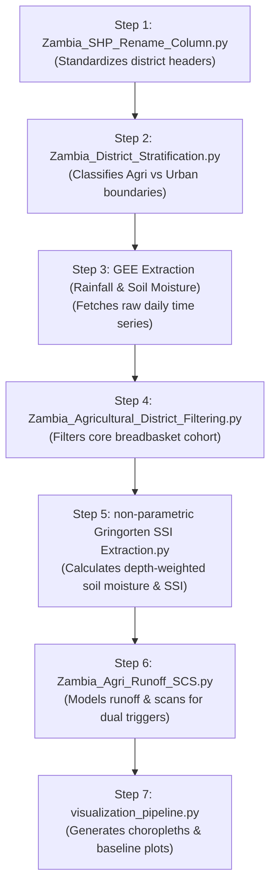

# Zambia Agricultural Flood Risk Model — Script Sequence Justification

This document explains why the script execution order is correct and makes methodological sense for the Agricultural Saturation Flooding (Regime B - Rural) analysis.

---

## 🛠️ Analysis of the Script Sequence

The scripts must be executed in this specific sequence because each step relies on the output, boundaries, or filters established by the preceding script.

---

### Step 1: Boundaries and Renaming
* **Script:** `utils/Zambia_SHP_Rename_Column.py`
* **Justification:** Standardizes the district name header (e.g. `NAME_2` or `District_N` from standard GADM shapefiles) to a uniform name: `Admin_2`.
* **Why first?** Tabular data joins and spatial groupings are highly sensitive to spelling, casing, and headers. Renaming first prevents silent data mismatches in all subsequent scripts.

### Step 2: Dual-Regime Stratification
* **Script:** `utils/Zambia_District_Stratification.py`
* **Justification:** Delineates Zambia into 70 Agricultural Districts, 12 Urban/Industrial Districts, and marginal land using built-up and cropland coverage fractions from ESA WorldCover and GHSL SMOD.
* **Why second?** Before executing biophysical calculations, you must establish **where** each flood model applies. You cannot filter climate datasets for agricultural zones without first defining those boundaries.

### Step 3: Google Earth Engine Climate & Soil Moisture Extraction
* **Scripts:** 
  * `data_acquisition/CHIRP_data acquition_Zambia.py`
  * `data_acquisition/Zambia_ERA5_Soil_Moisture_Daily_Extraction.py`
* **Justification:** Queries and downloads historical daily rainfall (CHIRPS) and daily volumetric soil water layers (ERA5-Land) per district for the 25-year study window (2000–2025).
* **Why third?** You retrieve the raw daily parameters only after specifying the target boundaries. This step generates the massive base master time series files.

### Step 4: Crop Domain Filtering
* **Script:** `utils/Zambia_Agricultural_District_Filtering.py`
* **Justification:** Excludes marginal districts to isolate the core breadbaskets using the **Becker-Reshef (95% cumulative cropland area)** and **Rembold (15% crop density)** thresholds.
* **Why fourth?** You have daily soil moisture for the entire country, but you need to isolate crop-dominant areas. Areas with $<15\%$ crop density produce noisy climate signals because daily values are dominated by forest, water, or background grasses rather than active croplands. This reduces the raw datasets into the final agricultural study cohort.

### Step 5: Index Extraction
* **Script:** `script/non-parametric Gringorten SSI Extraction.py`
* **Justification:** Aggregates soil depth layers into a depth-weighted $0\text{--}100\text{ cm}$ root zone profile and calculates the non-parametric Standardized Soil Moisture Index (SSI) using the Gringorten plotting position method per day-of-year (DOY) to isolate anomalies.
* **Why fifth?** This step requires the clean, crop-filtered dataset from Step 4. Gringorten SSI acts as the **saturation baseline index** (representing the "Full Sponge" condition) and is filtered for the November–April growing season.

### Step 6: SCS Runoff Calculation & Trigger Matching
* **Script:** `script/Zambia_Agri_Runoff_SCS.py`
* **Justification:** Models daily surface runoff depth ($Q$) from CHIRPS precipitation using the USDA SCS Curve Number model ($CN = 85$) and matches it with the daily soil saturation (SSI) calculated in Step 5.
* **Why sixth?** To determine if a saturation flood occurred, you need both the **soil saturation** (SSI) and **water inflow/runoff** (SCS Runoff). This script merges the two variables and identifies events meeting the dual-trigger criteria ($SSI \ge 1.5$ AND $Runoff \ge 20\text{ mm}$).
* **Output:** `output/Agri_Flood_Trigger_Catalog.csv`

### Step 7: Dashboards and Visualizations
* **Scripts:** 
  * `visualisations/visualization_pipeline.py`
  * `visualisations/plot_agri_trigger_analysis.py`
* **Justification:** Generates interactive choropleth maps (cropland fraction, trigger frequency counts) and line charts (baseline comparison profiles) from the final output datasets.
* **Why seventh?** You cannot plot inputs, outputs, or spatial triggers until they have all been calculated and cataloged in the previous steps.
